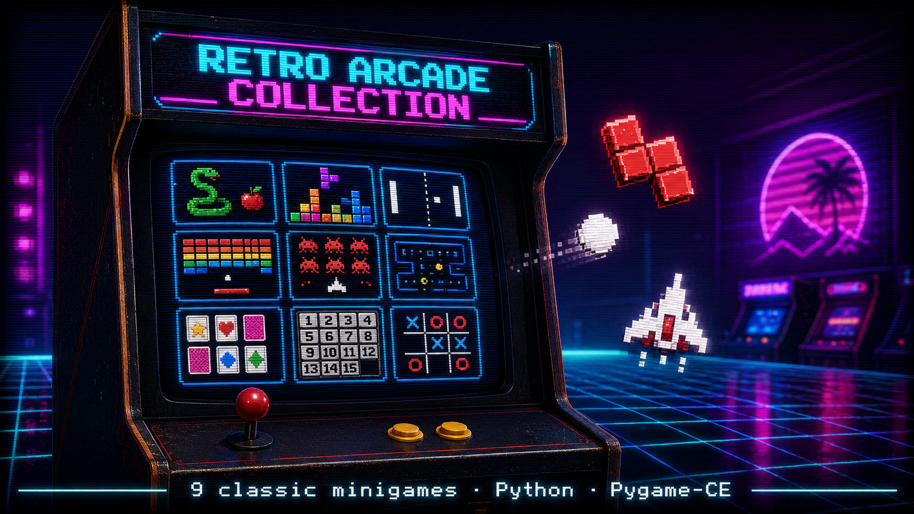
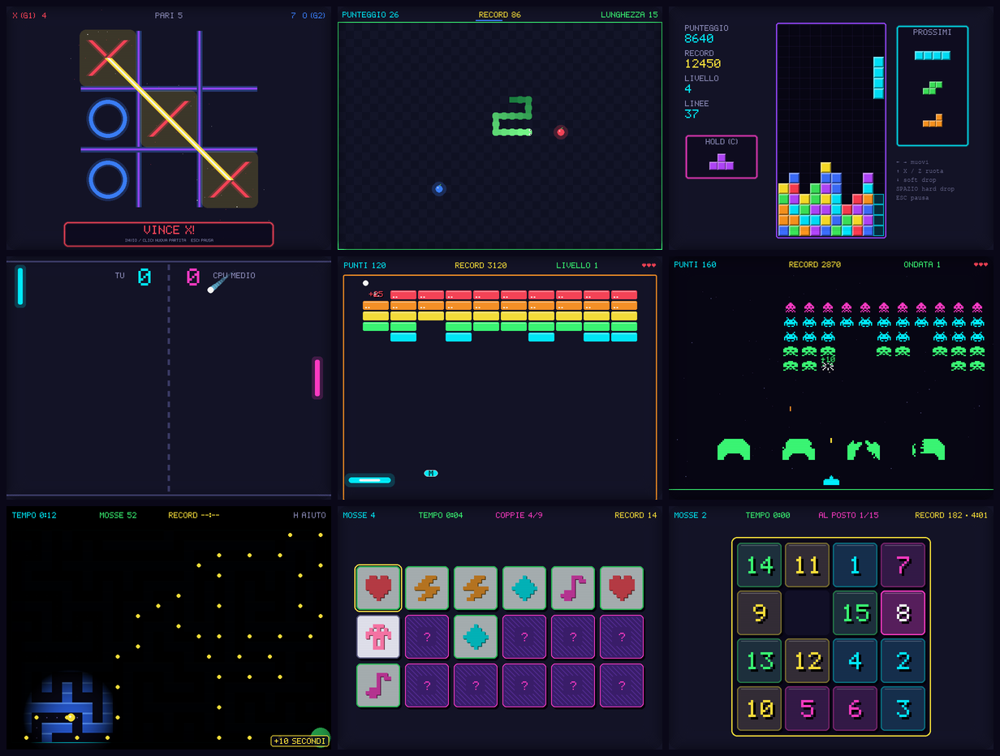
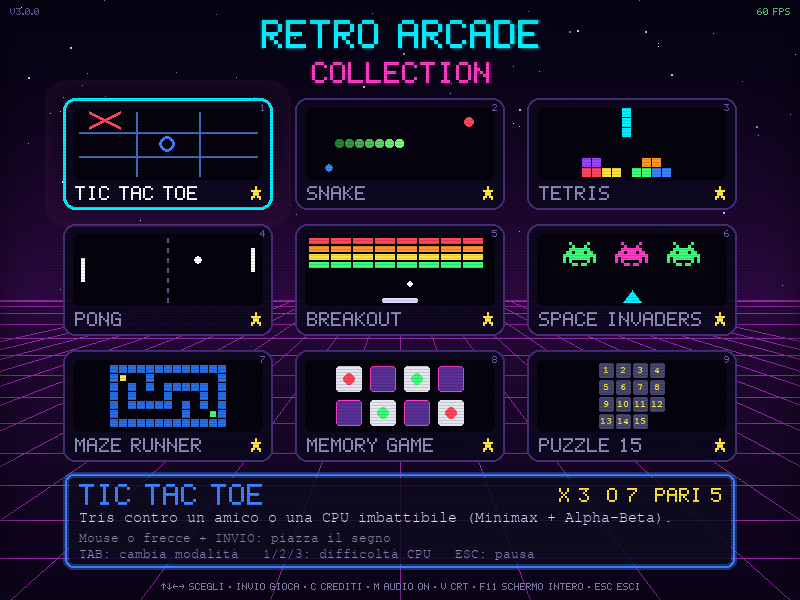
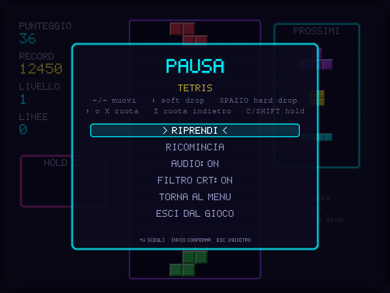

# 🕹️ Retro Arcade Collection

> Nove minigiochi arcade classici in Python + Pygame-CE, con un launcher synthwave, audio chiptune sintetizzato in tempo reale e zero file di risorse obbligatori.




---

## ✨ Highlights

- 🎮 **9 giochi classici** in un unico launcher: griglia prospettica animata, stelle, glow al neon, filtro CRT
- 🔤 **Font bitmap 5×7 fatto a mano**: titoli in vero pixel-art, nitidi a ogni scala, nessun file font da distribuire
- 🔊 **Audio chiptune sintetizzato al volo** (onde quadre, triangolari e rumore, come i chip anni '80): nessun file audio
- 🧠 **Motore AI** con Minimax + tabella di trasposizione e Alpha-Beta: al Tris la CPU "Impossibile" è dimostrata imbattibile da un test esaustivo
- 💾 **Record persistenti** in JSON con scrittura atomica (niente file corrotti se il PC si spegne a metà salvataggio)
- 🖥️ **Finestra scalabile** e **schermo intero** (F11) con proporzioni corrette, **screenshot** con F12
- ✅ **144 test automatici** (logica + partite "giocate" senza finestra) e lint con Ruff
- 📦 **Eseguibile standalone** con PyInstaller, con ricetta pronta

## 🖼️ Screenshot



| Launcher | Menu di pausa |
|---|---|
|  |  |

## 🎮 Giochi inclusi

| Gioco | Caratteristiche principali |
|-------|---------------------------|
| **Tic Tac Toe** | VS CPU (Facile / Medio / Impossibile) o 2 giocatori, chi inizia si alterna, segni al neon animati, linea vincente animata |
| **Snake** | Input bufferizzato (curve rapide), frutto bonus a tempo con barra, particelle, velocità crescente |
| **Tetris** | Rotazione **SRS** con wall kick, **7-bag**, lock delay, hold, ghost piece, 3 pezzi in anteprima, auto-shift (DAS/ARR) |
| **Pong** | CPU che **prevede i rimbalzi** con 3 livelli, palla che accelera, angolo di rimbalzo controllabile, countdown al servizio |
| **Breakout** | 5 livelli (poi ciclici e più veloci), mattoni da 1-3 colpi, collisioni sub-step, power-up: paddle largo, multi-palla, rallentatore, vita |
| **Space Invaders** | 3 tipi di alieni animati, marcia che accelera col classico basso a 4 note, scudi che si sgretolano, UFO bonus |
| **Maze Runner** | Labirinti perfetti generati con DFS, 4 difficoltà incluso **"al buio"** con torcia, suggerimento **BFS** (+10 s) |
| **Memory Game** | 3 griglie (4×3, 6×3, 6×4), 12 icone pixel-art, vero flip 3D, combo, giocabile anche da tastiera |
| **Puzzle 15** | Sempre risolvibile (test di parità corretto), scorrimento di intere file con un clic, tessere al posto giusto evidenziate |

## 🚀 Installazione

### Requisiti

- [Python](https://www.python.org/downloads/) **3.10** o superiore
- pip (incluso in Python)

### Setup

```bash
# Clona la repo
git clone https://github.com/sirAlfry/retro-arcade-collection.git
cd retro-arcade-collection

# (Consigliato) Crea e attiva un virtual environment
python -m venv venv
# Windows:
venv\Scripts\activate
# macOS / Linux:
source venv/bin/activate

# Installa le dipendenze
pip install -r requirements.txt
```

### Avvio

```bash
python retro_arcade_interface.py                 # launcher
python retro_arcade_interface.py --game tetris   # entra direttamente in un gioco
python retro_arcade_interface.py --save menu.png # salva un'immagine del menu (senza finestra)
python snake.py                                  # ogni gioco funziona anche da solo
```

## 🎯 Controlli

### Launcher

| Tasto | Azione |
|-------|--------|
| ⬆️ ⬇️ ⬅️ ➡️ / WASD / mouse | Scegli il gioco |
| `Invio` / `Spazio` / clic | Avvia il gioco selezionato |
| `1` … `9` | Avvia direttamente il gioco numero N |
| `C` | Crediti |
| `M` | Audio on/off |
| `V` | Filtro CRT on/off |
| `ESC` / `Q` | Esci |

### Ovunque

| Tasto | Azione |
|-------|--------|
| `F11` (o `Alt+Invio`) | Schermo intero on/off |
| `F12` | Screenshot in `screenshots/` |
| `ESC` / `P` (in gioco) | Menu di pausa: Riprendi · Ricomincia · Audio · Filtro CRT · Torna al menu · Esci (scorciatoie `R` `M` `Q`) |

<details>
<summary><b>Controlli di ogni gioco</b></summary>

| Gioco | Controlli |
|-------|-----------|
| Tic Tac Toe | Clic o frecce + `Invio` · `TAB` VS CPU / 2 giocatori · `1` `2` `3` difficoltà CPU · `R` nuova partita |
| Snake | Frecce o WASD |
| Tetris | `←` `→` muovi · `↓` soft drop · `Spazio` hard drop · `↑`/`X` ruota · `Z` ruota indietro · `C`/`Shift` hold |
| Pong | Giocatore 1: `W` `S` (in 1P anche le frecce) · Giocatore 2: `↑` `↓` |
| Breakout | Mouse o frecce / `A` `D` · `Spazio` o clic per lanciare la palla |
| Space Invaders | Frecce o `A` `D` · `Spazio` spara |
| Maze Runner | Frecce o WASD (tieni premuto per correre) · `H` suggerimento |
| Memory Game | Clic, oppure frecce + `Invio` |
| Puzzle 15 | Clic su una tessera nella riga/colonna del buco · frecce · `R` rimescola |

</details>

## 💾 Record e impostazioni

I record (punteggi, tempi migliori, mosse minime, vittorie a Tris e a Pong) e le impostazioni (audio, filtro CRT, ultimo gioco scelto) sono salvati in **`scores.json`**:

1. nella cartella del programma (accanto a `retro_arcade_interface.py` o all'`.exe`);
2. se quella cartella non è scrivibile (es. `C:\Program Files`), in `%APPDATA%\RetroArcadeCollection` su Windows o `~/.local/share/retro-arcade-collection` su Linux/macOS;
3. oppure dove indica la variabile d'ambiente `RETRO_ARCADE_SCORES`.

Per azzerare i record basta cancellare il file. Se il file risulta danneggiato viene rinominato in `scores.json.corrupt` e il gioco riparte da zero senza bloccarsi.

## 🏗️ Architettura

```
retro-arcade-collection/
├── retro_arcade_interface.py   # Launcher: catalogo giochi, sfondo synthwave, crediti, CLI
├── game_shared.py              # Toolkit comune: finestra, menu, font, particelle, timer, CRT
├── pixel_font.py               # Font bitmap 5x7 con cache di rendering
├── sfx.py                      # Sintetizzatore chiptune (effetti generati in codice)
├── scores.py                   # Salvataggi JSON atomici + impostazioni
├── game_ai.py                  # Motore AI: Random / Heuristic / Minimax / Alpha-Beta
├── snake.py  tetris.py  pong.py  breakout.py  space_invaders.py
├── maze_runner.py  memory_game.py  puzzle15.py  tris.py
├── tests/                      # pytest: logica, AI, salvataggi, smoke test di ogni gioco
├── packaging/
│   └── RetroArcadeCollection.spec   # ricetta PyInstaller
├── docs/
│   ├── GDD_retro_arcade_collection.docx   # Game Design Document
│   └── screenshots/
├── assets/                     # banner, icona .png/.ico
├── tools/                      # utility di sviluppo (non fanno parte del gioco)
├── pyproject.toml              # metadati, configurazione pytest e ruff
├── requirements.txt            # dipendenze per giocare
└── requirements-dev.txt        # dipendenze per sviluppare / testare / buildare
```

### Pattern e scelte tecniche

- **Catalogo unico + dispatch dinamico**: in `retro_arcade_interface.py` la tupla `GAMES` descrive ogni gioco (modulo, funzione, descrizione, controlli, formato del record, colore). Da lì derivano le tessere, il pannello info e l'import on-demand con `importlib.import_module()`. Aggiungere un decimo gioco = aggiungere una riga.
- **Contratto comune dei giochi**: `main(load_scores=None, save_scores=None) -> "menu" | "quit"`. I giochi non chiamano mai `pygame.quit()`: è il launcher a chiudere tutto, una volta sola.
- **Logica separata dalla grafica**: `TetrisLogic`, `SnakeLogic`, le funzioni di Puzzle 15 e del labirinto sono pure (niente pygame) e quindi testabili in millisecondi.
- **Persistenza disaccoppiata**: i giochi ricevono `load_scores`/`save_scores` come callable; nei test si usa uno store in memoria (`scores.memory_store()`).
- **Una sola finestra** creata con `pygame.SCALED | pygame.RESIZABLE`: si disegna sempre su 800×600, la finestra si ridimensiona o va a schermo intero senza sfocature né sfarfallii tra un gioco e l'altro.
- **Cache ovunque serva**: font (LRU da 32), testi pixel (LRU da 256), sprite dei blocchi, overlay CRT pre-renderizzato.
- **Tempo reale, non frame**: la fisica usa i secondi (`dt`) con un limite (`MAX_DT`), così il gioco gira uguale a 30, 60 o 144 Hz e non "salta" dopo una pausa.

## ✅ Test e qualità del codice

```bash
pip install -r requirements-dev.txt
python -m pytest          # 144 test, ~10 secondi, nessuna finestra aperta
ruff check .              # linter
```

I test usano i driver "dummy" di SDL (niente schermo né scheda audio), quindi non aprono finestre e non suonano mentre girano. Oltre alla logica, gli **smoke test giocano davvero** ogni gioco per qualche centinaio di frame con input simulati. Il test dell'AI esplora **tutte** le partite possibili contro la CPU "Impossibile" e verifica che non perda mai.

Consiglio: lancia `python -m pytest` e `ruff check .` prima di ogni commit, così ti accorgi subito se qualcosa si è rotto.

## 📦 Build eseguibile

```bash
pip install -r requirements-dev.txt
pyinstaller packaging/RetroArcadeCollection.spec
```

Il file singolo `RetroArcadeCollection.exe` (o `RetroArcadeCollection` su Linux/macOS) compare in `dist/`. L'icona si rigenera con `python tools/make_icon.py`.

## 📖 Game Design Document

Dettagli completi su design, regole di ogni gioco e scelte tecniche: [docs/GDD_retro_arcade_collection.docx](docs/GDD_retro_arcade_collection.docx). Lo storico delle modifiche è nel [CHANGELOG](CHANGELOG.md).

## 🛠️ Stack tecnologico (e dove approfondire)

| Tecnologia | Uso | Per saperne di più |
|---|---|---|
| Python 3.10+ | Linguaggio | [docs.python.org](https://docs.python.org/3/) |
| Pygame-CE | Grafica, input, audio | [pyga.me/docs](https://pyga.me/docs/) |
| pytest | Test automatici | [docs.pytest.org](https://docs.pytest.org/) |
| Ruff | Linter | [docs.astral.sh/ruff](https://docs.astral.sh/ruff/) |
| PyInstaller | Eseguibile standalone | [pyinstaller.org](https://pyinstaller.org/en/stable/) |

Curiosità sugli algoritmi usati: [Super Rotation System](https://tetris.wiki/Super_Rotation_System) e [7-bag](https://tetris.wiki/Random_Generator) (Tetris), [Minimax](https://it.wikipedia.org/wiki/Minimax) e [potatura alfa-beta](https://it.wikipedia.org/wiki/Potatura_alfa-beta) (Tris), [generazione di labirinti con DFS](https://en.wikipedia.org/wiki/Maze_generation_algorithm) e [BFS](https://it.wikipedia.org/wiki/Ricerca_in_ampiezza) (Maze Runner), [risolvibilità del gioco del 15](https://it.wikipedia.org/wiki/Gioco_del_quindici).

## 🗺️ Idee per il futuro

- Classifica locale con le iniziali del giocatore (le classiche 3 lettere da sala giochi)
- Supporto ai gamepad (`pygame.joystick`)
- Musica di sottofondo chiptune generata dallo stesso sintetizzatore
- Versione web giocabile dal browser con [pygbag](https://pypi.org/project/pygbag/)

## 👤 Autore

**Alfredo De Donno** — Full-Stack Developer & Game Dev

- GitHub: [@sirAlfry](https://github.com/sirAlfry)
- LinkedIn: [Alfredo De Donno](https://www.linkedin.com/in/alfredo-de-donno-46b178210)
- ArtStation: [@siralfry](https://www.artstation.com/siralfry)
- Instagram (divulgazione tech): [@sir_alfry](https://www.instagram.com/sir_alfry)

## 📄 Licenza

Distribuito sotto licenza MIT. Vedi [LICENSE](LICENSE) per i dettagli.

---

<p align="center">
  <em>Fatto con ☕, pygame e nostalgia per le sale giochi anni '80.</em>
</p>
